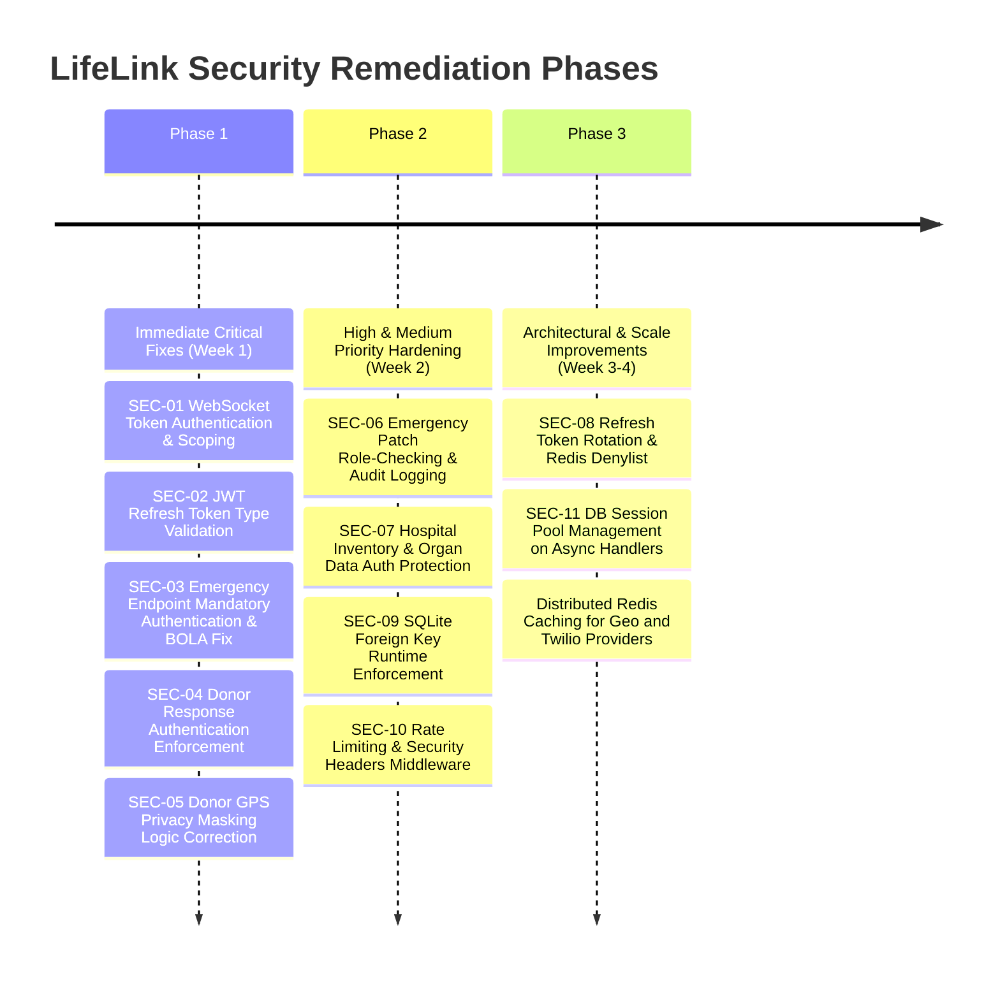

# LifeLink Backend Security and Production-Readiness Audit Report

**Document Version:** 1.0.0  
**Audit Date:** October 26, 2026  
**Auditor:** Senior Backend Security & Cloud Infrastructure Review Team  
**Scope:** LifeLink Healthcare Emergency Coordination Platform (`backend/app`, `alembic`, `tests`)  
**Baseline Test Status:** 453 Passed, 8 Skipped, 0 Failed (Clean baseline)  
**Classification:** Internal Clinical & Technical Assessment  

---

## 1. Executive Summary

A comprehensive, read-only security architecture and production-readiness evaluation was conducted across the LifeLink backend service. LifeLink is a mission-critical emergency coordination system handling life-sensitive workflows, including emergency blood donor mobilization, organ viability tracking, and live ambulance telemetry dispatch.

### 1.1 Architecture & Design Strengths
The platform exhibits commendable security and safety-first engineering practices in several domains:
* **Timing-Attack Resilient Authentication:** `AuthService.login` utilizes a pre-computed dummy bcrypt verification hash when user accounts are not found, neutralizing timing-based user enumeration.
* **Role Escalation Defense:** Registration endpoints strictly isolate self-service roles (`donor`, `patient`) from clinical/administrative roles, automatically placing professional registrations (`doctor`, `ambulance_driver`) into a restricted `pending` verification state.
* **Clinical Boundary Protection:** The baseline donor matching engine enforces strict non-negotiable medical eligibility rules (zero override tolerance for ABO/Rh incompatibility or donation cooldowns) before any geographic or heuristic operational ranking is evaluated.
* **Carrier Isolation & Safety Gates:** Live SMS and WhatsApp dispatch requires explicit human activation (`TWILIO_LIVE_ENABLED=True` and `MOCK_NOTIFICATIONS_ONLY=False`), backed by hourly recipient rate limits, cost caps, and an automatic circuit breaker.
* **Protected Database & Migration Safeguards:** Fail-fast guards prevent test scripts and development seeders from writing to canonical production databases.

### 1.2 Key Security & Architectural Deficiencies
Despite these strengths, the audit identified several **Critical** and **High-Severity** vulnerabilities that must be remediated prior to clinical production deployment:
1. **Unauthenticated Public WebSocket Gateway:** The root and API WebSocket endpoints (`/ws` and `/api/v1/realtime/ws`) require no authentication or authorization headers/tokens, broadcasting live emergency locations, patient IDs, donor interactions, and ambulance GPS coordinates to any anonymous listener.
2. **JWT Refresh Token Usable as Access Token:** `get_current_user` decodes incoming JWT tokens without validating the token `type` claim, allowing 7-day refresh tokens to be used as Bearer tokens across all authenticated REST endpoints, bypassing the 120-minute access token limit.
3. **Broken Object Level Authorization (BOLA) on Emergencies:** `GET /emergencies` and `GET /emergencies/{emergency_id}` permit unauthenticated access via `get_optional_current_user`, completely bypassing patient data isolation and leaking clinical emergency details and GPS coordinates.
4. **Unauthenticated & Forgeable Donor Responses:** `POST /blood/donors/{donor_id}/response` fails to enforce authentication when callers omit credentials, allowing anonymous actors to forge donor acceptance/rejection states.
5. **Donor Location Privacy Leakage:** A logical flaw in `DonorService._map_donor_to_response` exposes exact GPS coordinates of donors who consented to emergency mobilization to non-privileged or unauthenticated users.
6. **Privilege Escalation on Emergency Mutation:** `PATCH /emergencies/{emergency_id}` enforces authentication but lacks role-based access checks, permitting donors or patients to alter emergency priority, status, and coordinates without generating audit log records.

### 1.3 Audit Assessment Matrix

| Finding ID | Title | Severity | Category | Status |
| :--- | :--- | :--- | :--- | :--- |
| **SEC-01** | Unauthenticated Real-Time WebSocket Gateway Broadcasting PII & Telemetry | **CRITICAL** | Authorization / Privacy | Confirmed |
| **SEC-02** | Refresh Token Accepted as Access Token in Core Authentication Dependency | **HIGH** | Authentication | Confirmed |
| **SEC-03** | Broken Object Level Authorization (BOLA) & Anonymous Emergency Access | **HIGH** | Authorization / Privacy | Confirmed |
| **SEC-04** | Anonymous and Impersonated Donor SOS Response Submission | **HIGH** | Access Control / Integrity | Confirmed |
| **SEC-05** | Donor GPS Coordinate Privacy Leakage in Public Serializer | **HIGH** | Privacy / Data Protection | Confirmed |
| **SEC-06** | Missing Role Checks and Unaudited State Changes on Emergency Patching | **HIGH** | Authorization / Auditability | Confirmed |
| **SEC-07** | Anonymous Access to Facility Inventories, Emergencies, and Organ Data | **MEDIUM** | Information Disclosure | Confirmed |
| **SEC-08** | Stateless Refresh Tokens Without Invalidation or Family Rotation | **MEDIUM** | Session Management | Confirmed |
| **SEC-09** | SQLite Foreign Key Constraints Not Enforced at Engine Level | **MEDIUM** | Data Integrity | Confirmed |
| **SEC-10** | Missing Rate Limiting and Security Response Headers Middleware | **MEDIUM** | Hardening / DoS Protection | Confirmed |
| **SEC-11** | Synchronous DB Session Contention on Async Route Handlers | **LOW** | Performance / Reliability | Confirmed |

---

## 2. Confirmed Findings with Evidence & Remediation

---

### Finding SEC-01: Unauthenticated Real-Time WebSocket Gateway Broadcasting PII & Telemetry
* **Severity:** **CRITICAL**
* **OWASP API Security Top 10:** API1:2023 - Broken Object Level Authorization / API2:2023 - Broken Authentication
* **Affected Files & Lines:**
  * [app/main.py](file:///d:/Studies/projects/Life%20Link/Life-Link/app/main.py#L167-L177) (lines 167–177)
  * [app/api/v1/realtime.py](file:///d:/Studies/projects/Life%20Link/Life-Link/app/api/v1/realtime.py#L8-L21) (lines 8–21)
  * [app/realtime/manager.py](file:///d:/Studies/projects/Life%20Link/Life-Link/app/realtime/manager.py#L34-L45) (lines 34–45)

#### Evidence
In `app/main.py`:
```python
# app/main.py:167-177
@app.websocket("/ws")
async def root_websocket(websocket: WebSocket):
    await ws_manager.connect(websocket)
    try:
        while True:
            await websocket.receive_text()
    except WebSocketDisconnect:
        ws_manager.disconnect(websocket)
    except Exception:
        ws_manager.disconnect(websocket)
```
In `app/realtime/manager.py`:
```python
# app/realtime/manager.py:34-45
async def broadcast(self, event: RealtimeEvent):
    """Broadcasts a real-time event to all connected clients."""
    disconnected = []
    for connection in self.active_connections:
        try:
            await connection.send_json(event.model_dump())
        except Exception:
            disconnected.append(connection)
    for conn in disconnected:
        self.disconnect(conn)
```
When emergencies are registered (`emergency_service.py:239`), ambulance positions ingest telemetry (`ambulance_service.py:206`), or donors accept emergency alerts (`donor_service.py:1140`), `ws_manager.broadcast_sync` transmits full JSON payloads containing emergency IDs, coordinates, ambulance speeds, and donor statuses. Because neither `/ws` nor `/api/v1/realtime/ws` validates incoming connections or requires a JWT token, any unauthorized external client can connect to `ws://host/ws` and listen to real-time healthcare intelligence and patient locations.

#### Remediation
1. Enforce JWT authentication on the WebSocket connection handshake using a ticket query parameter or headers:
   ```python
   @app.websocket("/ws")
   async def root_websocket(websocket: WebSocket, token: Optional[str] = Query(None)):
       if not token:
           await websocket.close(code=status.WS_1008_POLICY_VIOLATION)
           return
       payload = decode_token(token)
       if not payload or payload.get("type") != "access":
           await websocket.close(code=status.WS_1008_POLICY_VIOLATION)
           return
       # Authenticate and associate user/role with socket
   ```
2. Implement room-based or channel-based subscription controls in `ConnectionManager`. Clients should only receive updates for emergencies or hospitals they have legitimate clinical or operational authorization to view.

---

### Finding SEC-02: Refresh Token Accepted as Access Token in Core Authentication Dependency
* **Severity:** **HIGH**
* **OWASP API Security Top 10:** API2:2023 - Broken Authentication
* **Affected Files & Lines:**
  * [app/core/dependencies.py](file:///d:/Studies/projects/Life%20Link/Life-Link/app/core/dependencies.py#L30-L40) (lines 30–40)
  * [app/core/security.py](file:///d:/Studies/projects/Life%20Link/Life-Link/app/core/security.py#L48-L56) (lines 48–56)

#### Evidence
In `app/core/security.py`, refresh tokens are issued with a distinct `type: "refresh"` claim and a 7-day expiration window (`JWT_REFRESH_TOKEN_EXPIRE_DAYS = 7`):
```python
# app/core/security.py:53
to_encode.update({"exp": expire, "sub": str(subject), "type": "refresh"})
```
However, in `app/core/dependencies.py`, the core authentication dependency `get_current_user` extracts the `sub` claim without verifying that `type == "access"`:
```python
# app/core/dependencies.py:30-36
def get_current_user(token: str = Depends(oauth2_scheme), db: Session = Depends(get_db)) -> UserProfileSchema:
    payload = decode_token(token)
    if payload is None:
        raise credentials_exception
    user_id: str = payload.get("sub")
    if user_id is None:
        raise credentials_exception
```
Because the `type` claim is never checked, any valid refresh token can be used as a Bearer token across all authenticated endpoints (`/api/v1/emergencies`, `/api/v1/users`, etc.). This renders the 120-minute access token expiration window (`JWT_ACCESS_TOKEN_EXPIRE_MINUTES = 120`) completely ineffective, granting callers a 7-day access window on every refresh token.

#### Remediation
Validate the token `type` claim within `get_current_user`:
```python
token_type = payload.get("type")
if token_type != "access":
    raise HTTPException(
        status_code=status.HTTP_401_UNAUTHORIZED,
        detail="Invalid token type: Expected access token",
        headers={"WWW-Authenticate": "Bearer"},
    )
```

---

### Finding SEC-03: Broken Object Level Authorization (BOLA) & Anonymous Emergency Access
* **Severity:** **HIGH**
* **OWASP API Security Top 10:** API1:2023 - Broken Object Level Authorization / API3:2023 - Broken Object Property Level Authorization
* **Affected Files & Lines:**
  * [app/api/v1/emergencies.py](file:///d:/Studies/projects/Life%20Link/Life-Link/app/api/v1/emergencies.py#L28-L49) (lines 28–49, 89–95)
  * [app/services/emergency_service.py](file:///d:/Studies/projects/Life%20Link/Life-Link/app/services/emergency_service.py#L64-L81) (lines 64–81, 83–96)

#### Evidence
In `app/api/v1/emergencies.py`:
```python
# app/api/v1/emergencies.py:28-38
def list_emergencies(
    ...
    current_user: Optional[UserProfileSchema] = Depends(get_optional_current_user),
    db: Session = Depends(get_db),
):
    return emergency_service.get_all(db=db, current_user=current_user, ...)
```
In `app/services/emergency_service.py`:
```python
# app/services/emergency_service.py:64-67
query = db.query(Emergency)
if current_user and current_user.role == UserRole.PATIENT.value:
    query = query.filter(Emergency.patient_id == current_user.id)
...
return [EmergencyService._map_emergency_to_response(e) for e in emergencies]
```
When an unauthenticated caller queries `GET /api/v1/emergencies`, `current_user` is `None`. Consequently, the patient isolation filter is bypassed, and the endpoint returns **all active and historical emergencies** across the entire hospital network, including `patientId`, `description`, `locationLat`, `locationLng`, `unitsRequired`, and `assignedResourceIds`.

Similarly, `GET /api/v1/emergencies/{emergency_id}` uses `get_optional_current_user`. If `current_user is None`, line 90 (`if current_user and current_user.role == UserRole.PATIENT.value:`) does not execute, allowing unauthenticated callers to view full emergency records by ID.

#### Remediation
1. Replace `Depends(get_optional_current_user)` with mandatory authentication `Depends(get_current_user)`.
2. Enforce strict authorization rules:
   * **Patients:** Can only view emergencies where `emergency.patient_id == current_user.id`.
   * **Hospital Staff / Doctors:** Can only view emergencies affiliated with their assigned `hospital_id`.
   * **Ambulance Operators / Transplant Coordinators:** Can only view emergencies matching their domain assignment.
   * **Admins:** Unrestricted network visibility.

---

### Finding SEC-04: Anonymous and Impersonated Donor SOS Response Submission
* **Severity:** **HIGH**
* **OWASP API Security Top 10:** API1:2023 - Broken Object Level Authorization / API2:2023 - Broken Authentication
* **Affected Files & Lines:**
  * [app/api/v1/blood.py](file:///d:/Studies/projects/Life%20Link/Life-Link/app/api/v1/blood.py#L104-L118) (lines 104–118)
  * [app/services/donor_service.py](file:///d:/Studies/projects/Life%20Link/Life-Link/app/services/donor_service.py#L1032-L1039) (lines 1032–1039, 1118–1120)

#### Evidence
In `app/api/v1/blood.py`:
```python
# app/api/v1/blood.py:104-114
@router.post("/donors/{donor_id}/response")
def record_response(
    donor_id: str,
    body: DonorResponseRequest,
    current_user: Optional[UserProfileSchema] = Depends(get_optional_current_user),
    db: Session = Depends(get_db),
):
    return donor_service.record_donor_response(
        db, donor_id, body.status, share_location=body.shareLocation or False, current_user=current_user
    )
```
In `app/services/donor_service.py`:
```python
# app/services/donor_service.py:1033-1038
# Authorization: If logged in as donor, ensure they are responding ONLY to their own donor profile
if current_user and current_user.role == "donor":
    if not donor.user_id or donor.user_id != current_user.id:
        raise HTTPException(
            status_code=status.HTTP_403_FORBIDDEN,
            detail="Donors can only submit responses for their own profile",
        )
```
Notice that the ownership check **only executes if `current_user` is present AND `current_user.role == "donor"`**.
* If a caller provides **no authentication token** (`current_user is None`), the check is skipped entirely.
* If a caller is logged in as a **patient**, `current_user.role == "donor"` is False, and the check is also skipped.

As a result, an anonymous caller can invoke `POST /api/v1/blood/donors/{donor_id}/response` with arbitrary statuses (`accepted`, `declined`, `en_route`) for any donor in the system. The audit log then records the action as `actor = "Donor #<id>"`. This allows external adversaries to disrupt emergency operations by fabricating donor acceptances or mass-declining donor availability.

#### Remediation
1. Require authentication via `Depends(require_role([UserRole.DONOR, UserRole.DOCTOR, UserRole.HOSPITAL_STAFF, UserRole.ADMIN]))`.
2. If `current_user.role == UserRole.DONOR.value`, mandate `donor.user_id == current_user.id`.
3. If staff or doctor, ensure they are authorized for the corresponding emergency response.

---

### Finding SEC-05: Donor GPS Coordinate Privacy Leakage in Public Serializer
* **Severity:** **HIGH**
* **OWASP API Security Top 10:** API3:2023 - Broken Object Property Level Authorization
* **Affected Files & Lines:**
  * [app/services/donor_service.py](file:///d:/Studies/projects/Life%20Link/Life-Link/app/services/donor_service.py#L38-L45) (lines 38–45)

#### Evidence
In `DonorService._map_donor_to_response`:
```python
# app/services/donor_service.py:38-44
coords = None
if d.lat is not None and d.lng is not None:
    if not mask_coordinates or d.location_consent_granted:
        coords = Coordinates(lat=d.lat, lng=d.lng)
```
In `DonorService.get_all`:
```python
# app/services/donor_service.py:97
mask = current_user is None or current_user.role not in ["doctor", "hospital_staff", "admin"]
return [DonorService._map_donor_to_response(d, mask_coordinates=mask) for d in donors]
```
The Boolean logic `if not mask_coordinates or d.location_consent_granted:` evaluates to `True` whenever `d.location_consent_granted` is `True`, regardless of `mask_coordinates`. Because registered donors consent to emergency dispatch by setting `location_consent_granted = True`, their live GPS coordinates (`lat`, `lng`) are exposed to **any unprivileged user or patient** querying `GET /api/v1/donors`.

#### Remediation
Invert the boolean logic so that unprivileged users never receive exact coordinates:
```python
coords = None
if d.lat is not None and d.lng is not None:
    # Coordinates are only exposed if caller is privileged AND donor consented,
    # or if the caller is the donor themselves
    if not mask_coordinates and d.location_consent_granted:
        coords = Coordinates(lat=d.lat, lng=d.lng)
```

---

### Finding SEC-06: Missing Role Checks and Unaudited State Changes on Emergency Patching
* **Severity:** **HIGH**
* **OWASP API Security Top 10:** API5:2023 - Broken Function Level Authorization / API10:2023 - Unsafe Consumption of APIs
* **Affected Files & Lines:**
  * [app/api/v1/emergencies.py](file:///d:/Studies/projects/Life%20Link/Life-Link/app/api/v1/emergencies.py#L98-L109) (lines 98–109)
  * [app/services/emergency_service.py](file:///d:/Studies/projects/Life%20Link/Life-Link/app/services/emergency_service.py#L259-L300) (lines 259–300)

#### Evidence
In `app/api/v1/emergencies.py`:
```python
# app/api/v1/emergencies.py:98-109
@router.patch("/emergencies/{emergency_id}")
def update_emergency(
    emergency_id: str,
    data: EmergencyUpdate,
    current_user: UserProfileSchema = Depends(get_current_user),
    db: Session = Depends(get_db),
):
    return emergency_service.update(db, emergency_id, data, current_user)
```
In `app/services/emergency_service.py`:
```python
# app/services/emergency_service.py:259-279
@staticmethod
def update(db: Session, emergency_id: str, data: EmergencyUpdate, current_user: UserProfileSchema) -> EmergencyResponse:
    e = db.query(Emergency).filter(Emergency.id == emergency_id).first()
    if not e:
        raise HTTPException(status_code=404, detail="Emergency not found")

    if data.priority is not None:
        e.priority = data.priority
    if data.status is not None:
        e.status = data.status
    if data.eta is not None:
        e.eta = data.eta
    if data.locationLat is not None:
        e.location_lat = data.locationLat
    ...
    db.commit()
```
* **No Role Restriction:** The endpoint depends on `get_current_user`, accepting any authenticated user. Unlike `resolve` and `cancel` (which explicitly forbid patients and donors), `update` contains **no role checks**. A patient or donor can modify emergency priority, status, ETA, and coordinates for any emergency.
* **No State Transition Validation:** An emergency that is already `resolved` or `cancelled` can be updated back to `active` or arbitrarily altered.
* **Missing Audit Trail:** While `create`, `resolve`, and `cancel` generate comprehensive `AuditLog` and `EmergencyEvent` records, `update` commits changes silently without an audit log entry.

#### Remediation
1. Apply `require_role([UserRole.DOCTOR, UserRole.HOSPITAL_STAFF, UserRole.TRANSPLANT_COORDINATOR, UserRole.ADMIN])` on `PATCH /emergencies/{emergency_id}`.
2. Disallow updates to terminal states (`resolved`, `cancelled`).
3. Generate an `AuditLog` and `EmergencyEvent` detailing which fields were updated by whom.

---

### Finding SEC-07: Anonymous Access to Facility Inventories, Emergencies, and Organ Data
* **Severity:** **MEDIUM**
* **OWASP API Security Top 10:** API1:2023 - Broken Object Level Authorization
* **Affected Files & Lines:**
  * [app/api/v1/hospitals.py](file:///d:/Studies/projects/Life%20Link/Life-Link/app/api/v1/hospitals.py#L50-L69) (lines 50–69)
  * [app/api/v1/organs.py](file:///d:/Studies/projects/Life%20Link/Life-Link/app/api/v1/organs.py#L14-L38) (lines 14–38)
  * [app/api/v1/blood.py](file:///d:/Studies/projects/Life%20Link/Life-Link/app/api/v1/blood.py#L54-L63) (lines 54–63)

#### Evidence
The following endpoints lack authentication dependencies:
* `GET /api/v1/hospitals/{hospital_id}/emergencies`: Returns all active emergencies for a hospital to anonymous callers.
* `GET /api/v1/hospitals/{hospital_id}/inventory`: Returns blood stock levels and available trauma bays to anonymous callers.
* `GET /api/v1/organs` and `GET /api/v1/organs/{organ_id}`: Returns donor organ cold ischemic viability countdowns, medical rationale, and donor source hospital details without authentication.
* `GET /api/v1/blood/requests`: Lists all active blood emergency requests without credentials.

#### Remediation
Require at least standard user authentication (`Depends(get_current_user)`) across these operational and clinical resource queries.

---

### Finding SEC-08: Stateless Refresh Tokens Without Invalidation or Family Rotation
* **Severity:** **MEDIUM**
* **OWASP API Security Top 10:** API2:2023 - Broken Authentication
* **Affected Files & Lines:**
  * [app/services/auth_service.py](file:///d:/Studies/projects/Life%20Link/Life-Link/app/services/auth_service.py#L115-L147) (lines 115–147)

#### Evidence
In `AuthService.refresh_token`:
```python
# app/services/auth_service.py:115-147
user = db.query(User).filter(User.id == user_id).first()
...
new_access = create_access_token(user.id, extra_claims=claims)
new_refresh = create_refresh_token(user.id)
return TokenResponse(accessToken=new_access, refreshToken=new_refresh, ...)
```
When a client refreshes their token, the prior refresh token is neither revoked, invalidated, nor recorded in a revocation denylist. It remains valid for its full 7-day duration.
While `AuthService.logout` sets `user.session_status = "inactive"`, the subsequent login of that user resets `session_status = "active"`. Any refresh tokens leaked prior to logout immediately become functional again until their natural expiration.

#### Remediation
Implement single-use refresh token rotation (RTR) with a token identifier (`jti`) tracked in Redis or database table. Invalidate the entire token family if a reused refresh token is presented.

---

### Finding SEC-09: SQLite Foreign Key Constraints Not Enforced at Engine Level
* **Severity:** **MEDIUM**
* **Affected Files & Lines:**
  * [app/db/session.py](file:///d:/Studies/projects/Life%20Link/Life-Link/app/db/session.py#L10-L15) (lines 10–15)

#### Evidence
In `app/db/session.py`:
```python
# app/db/session.py:10-15
if is_sqlite:
    engine = create_engine(
        settings.DATABASE_URL,
        connect_args={"check_same_thread": False},
        pool_pre_ping=True,
    )
```
In SQLite, foreign key constraint checking is disabled by default for every connection unless `PRAGMA foreign_keys = ON;` is executed. While individual test files run this PRAGMA on isolated test connections, the runtime `engine` does not register a connection listener. Consequently, in local development and test environments running SQLite, queries can insert orphaned foreign key references (e.g. non-existent `hospital_id` or `user_id`) without raising database-level integrity errors, masking defects that would immediately crash on PostgreSQL.

#### Remediation
Register a SQLAlchemy event listener for SQLite connections in `app/db/session.py`:
```python
from sqlalchemy import event

if is_sqlite:
    @event.listens_for(engine, "connect")
    def set_sqlite_pragma(dbapi_connection, connection_record):
        cursor = dbapi_connection.cursor()
        cursor.execute("PRAGMA foreign_keys=ON")
        cursor.close()
```

---

### Finding SEC-10: Missing Rate Limiting and Security Response Headers Middleware
* **Severity:** **MEDIUM**
* **OWASP API Security Top 10:** API4:2023 - Unrestricted Resource Consumption
* **Affected Files & Lines:**
  * [app/main.py](file:///d:/Studies/projects/Life%20Link/Life-Link/app/main.py#L67-L77) (lines 67–77)

#### Evidence
* **No Rate Limiting:** `app/main.py` configures `CORSMiddleware` and global exception handlers, but installs no rate-limiting middleware. Public endpoints such as `/api/v1/auth/login`, `/api/v1/auth/register`, and `/api/v1/blood/donors/ranked` are vulnerable to brute-force credential stuffing and CPU-intensive calculation exhaustion.
* **Missing Security Headers:** Standard HTTP defense headers (`Strict-Transport-Security`, `X-Content-Type-Options: nosniff`, `X-Frame-Options: DENY`, `Referrer-Policy: strict-origin-when-cross-origin`) are not injected on HTTP responses.

#### Remediation
1. Attach `slowapi` or Redis-backed rate limiting to authentication and compute-intensive endpoints (e.g. max 5 login attempts per minute per IP).
2. Add a lightweight response middleware injecting OWASP-recommended security headers.

---

### Finding SEC-11: Synchronous DB Session Contention on Async Route Handlers
* **Severity:** **LOW / INFORMATIONAL**
* **Affected Files & Lines:**
  * [app/api/v1/emergencies.py](file:///d:/Studies/projects/Life%20Link/Life-Link/app/api/v1/emergencies.py#L150-L162) (lines 150–162)
  * [app/core/config.py](file:///d:/Studies/projects/Life%20Link/Life-Link/app/core/config.py#L56-L59) (lines 56–59)

#### Evidence
Several route definitions are declared with `async def` while injecting synchronous SQLAlchemy sessions via `db: Session = Depends(get_db)`:
```python
# app/api/v1/emergencies.py:150-155
async def get_accepted_donors_ranking(
    emergency_id: str,
    current_user: UserProfileSchema = Depends(require_role([...])),
    db: Session = Depends(get_db),
):
    return await donor_service.get_accepted_donors_ranking(db=db, ...)
```
When `donor_service.get_accepted_donors_ranking` performs asynchronous outbound HTTP requests (e.g., awaiting Google Maps Distance Matrix API responses), the synchronous SQLAlchemy session checked out from the pool (`QueuePool`, size 10) remains held across event loop yields. Under moderate concurrent load, this holds database pool slots idle waiting on third-party HTTP round trips, triggering connection pool exhaustion.

#### Remediation
Execute database reads and commit/close sessions before entering asynchronous third-party network I/O loops, or migrate route dependencies to async SQLAlchemy (`AsyncSession`).

---

## 3. Potential Risks Requiring Further Verification

1. **Third-Party Upstream Timeouts & Quota Ceilings:**
   * `GeospatialService` and `LLMService` have timeouts (6.0s and 8.0s), but under network partitions or high load, concurrent blocked requests could saturate Uvicorn worker threads. Verification should test behavior under upstream latency injection.
2. **In-Memory Cache Coherence Across Workers:**
   * Both `GeospatialService._cache` and `TwilioNotificationProvider._idempotency_cache` reside in process memory. In a multi-worker production configuration (e.g., Gunicorn with 4 workers), each worker maintains an isolated cache, allowing duplicate dispatches if requests hit alternate workers. Migration to Redis is recommended for distributed multi-instance deployments.
3. **PostgreSQL Compatibility in True Production:**
   * PostgreSQL compatibility was validated through schema migration tests and psycopg3 driver tests. Full operational testing with live PostGIS geographic indexing on PostgreSQL should be verified in a staging environment prior to final production cutover.

---

## 4. Items Already Implemented Correctly (Strengths)

The LifeLink codebase demonstrates strong security patterns that should be preserved:

1. **Bcrypt Dummy Hash Mitigation:**
   * `AuthService.login` uses `AuthService.DUMMY_BCRYPT_HASH` when an email is not found, protecting the system from timing attacks during credential validation.
2. **Self-Registration Role Privilege Constraints:**
   * `AuthService.register` limits direct registration to `patient`, `donor`, `doctor`, and `ambulance_driver`. Administrative, staff, and coordinator roles are strictly prohibited from self-registration.
3. **Medical Professional Verification Lifecycle:**
   * Professional accounts are provisioned with `verification_status="pending"` and `is_verified=False`. Sensitive operations (e.g. creating emergency requests, updating ambulance coordinates) strictly block pending/rejected professionals.
4. **Administrative Self-Verification Safeguard:**
   * In `app/api/v1/users.py`, `verify_user_account` verifies `admin_user.id != user_id`, preventing administrators from approving or modifying their own accounts.
5. **Deterministic Clinical Eligibility Hard-Filtering:**
   * `BaselineDonorMatchingEngine` executes non-negotiable medical compatibility and deferral filters prior to heuristic scoring, ensuring medically ineligible candidates are never ranked or dispatched.
6. **Synthetic vs. Production Data Isolation:**
   * Synthetic records and demo scenarios are strictly tagged with `is_synthetic=True` and `data_provenance`, preventing test data from polluting production metrics or generating real donor dispatches.
7. **Strict Carrier Isolation & Cost Controls:**
   * `TwilioNotificationProvider` incorporates dual safety gates (`MOCK_NOTIFICATIONS_ONLY` and `TWILIO_LIVE_ENABLED`), spend ceilings, recipient hourly limits, phone number masking, and an automatic circuit breaker.
8. **Protected Database Guards:**
   * `Settings.assert_isolated_target_for_write_testing` and `verify_isolated_postgresql_test_target` strictly prevent write tests or migration testing against canonical production databases.
9. **Environment-Specific Startup Validation:**
   * In `staging` and `production`, `Settings.validate_environment_security` prevents booting with default/insecure JWT keys or fallback SQLite databases.
10. **Tamper-Evident Audit Logging:**
    * Comprehensive audit logs are recorded for critical operations (`emergency create`, `resolve`, `cancel`, `donor response`, `user verification`, `organ review`). Audit logs are protected by `Permission.VIEW_AUDIT_LOGS`.

---

## 5. Prioritized Remediation Roadmap



### Phase 1: Immediate Critical Fixes (Pre-Production Blocker)
* **SEC-01:** Implement token handshake on `@app.websocket("/ws")` and `@router.websocket("/ws")`. Scope broadcasts to authorized rooms.
* **SEC-02:** Add `payload.get("type") == "access"` validation to `get_current_user`.
* **SEC-03:** Remove `get_optional_current_user` from `GET /emergencies` and `GET /emergencies/{id}`. Enforce patient/hospital data isolation.
* **SEC-04:** Require authentication and identity verification on `POST /blood/donors/{id}/response`.
* **SEC-05:** Fix privacy condition in `DonorService._map_donor_to_response` to `if not mask_coordinates and d.location_consent_granted:`.

### Phase 2: Role-Based Access & Middleware Hardening (Next Sprint)
* **SEC-06:** Apply `require_role` on `PATCH /emergencies/{id}` and record `AuditLog` and `EmergencyEvent` entries.
* **SEC-07:** Protect `hospitals/{id}/inventory`, `hospitals/{id}/emergencies`, and `organs` with `get_current_user`.
* **SEC-09:** Add `PRAGMA foreign_keys=ON` event listener to SQLAlchemy SQLite engine.
* **SEC-10:** Configure `slowapi` rate limiter on auth routes and inject OWASP security headers.

### Phase 3: Distributed State & Scalability (Pre-Launch)
* **SEC-08:** Implement single-use refresh token rotation with Redis revocation tracking.
* **SEC-11:** Refactor route handlers to avoid holding database pool connections during async third-party I/O.
* Migrate in-memory geospatial and idempotency caches to centralized Redis.

---

## 6. Tests Needed to Verify Future Fixes

When implementing the remediation roadmap, the following test cases must be added to the test suite:

1. **`test_websocket_authentication_rejected_without_token`:**
   * Connect to `/ws` without a token. Verify handshake is closed with `WS_1008_POLICY_VIOLATION`.
2. **`test_websocket_authentication_rejected_with_refresh_token`:**
   * Connect to `/ws` with a valid refresh token. Verify connection is rejected.
3. **`test_access_token_required_rejects_refresh_token`:**
   * Invoke an authenticated REST endpoint (e.g. `GET /api/v1/users/me`) with a valid refresh token. Verify response is `401 Unauthorized`.
4. **`test_emergency_list_unauthenticated_rejected`:**
   * Send `GET /api/v1/emergencies` without an `Authorization` header. Verify response is `401 Unauthorized`.
5. **`test_emergency_patient_isolation_enforced`:**
   * Log in as Patient A. Call `GET /api/v1/emergencies/{id}` where the emergency belongs to Patient B. Verify response is `403 Forbidden`.
6. **`test_donor_response_unauthenticated_rejected`:**
   * Call `POST /api/v1/blood/donors/{donor_id}/response` without credentials. Verify response is `401 Unauthorized`.
7. **`test_donor_response_donor_impersonation_blocked`:**
   * Log in as Donor A. Call `POST /api/v1/blood/donors/{donor_b_id}/response`. Verify response is `403 Forbidden`.
8. **`test_donor_coordinates_masked_for_non_privileged_users`:**
   * Log in as a patient or regular user. Query `GET /api/v1/donors`. Verify all `coordinates` fields in the response list are `None`, even when `locationConsentGranted` is `True`.
9. **`test_emergency_patch_disallowed_for_patients_and_donors`:**
   * Authenticate as a patient or donor. Send `PATCH /api/v1/emergencies/{id}` with new coordinates or priority. Verify response is `403 Forbidden`.
10. **`test_sqlite_runtime_foreign_keys_enforced`:**
    * In a test session without explicit manual PRAGMAs, attempt to insert an `Emergency` with an invalid `hospital_id`. Verify an `IntegrityError` is raised.

---

## 7. Final Production-Readiness Checklist

Use this checklist prior to staging/production sign-off:

### Authentication & Authorization
- [ ] Refresh tokens rejected when presented as access tokens (`SEC-02`)
- [ ] WebSocket gateway requires authenticated JWT token handshake (`SEC-01`)
- [ ] WebSocket broadcasts scoped by authorization room/channel (`SEC-01`)
- [ ] BOLA eliminated on all emergency query routes (`SEC-03`)
- [ ] Donor response recording strictly authenticated and identity-verified (`SEC-04`)
- [ ] Emergency PATCH endpoint restricted to clinical and administrative roles (`SEC-06`)
- [ ] Donor coordinates masked for all non-privileged callers (`SEC-05`)
- [ ] Public inspection endpoints for facility inventory and organs protected (`SEC-07`)

### Data Integrity & Database Operations
- [ ] SQLite foreign key enforcement active on engine connect (`SEC-09`)
- [ ] Alembic migrations tested against clean PostgreSQL 15+ instance with PostGIS
- [ ] In production, `APP_ENV=production` verified to block SQLite fallback and demo seeders
- [ ] Connection pool parameters configured for production database capacity

### Telephony & Third-Party Integrations
- [ ] `MOCK_NOTIFICATIONS_ONLY` and `TWILIO_LIVE_ENABLED` verified in environment settings
- [ ] Spend ceiling and hourly recipient rate limits active on SMS/WhatsApp providers
- [ ] Google Maps Distance Matrix API keys restricted by IP / HTTP referrer
- [ ] In-memory route and idempotency caches reviewed for multi-worker scaling

### Infrastructure & Security Hardening
- [ ] Rate limiting active on login, registration, and ranking endpoints (`SEC-10`)
- [ ] OWASP security headers enabled on all responses (`SEC-10`)
- [ ] CORS origins restricted to approved production domain names
- [ ] Logging verified: no raw passwords, JWT tokens, or unmasked patient phone numbers in logs
- [ ] Health check (`/health`) and readiness check (`/health/ready`) integrated with container orchestrator
